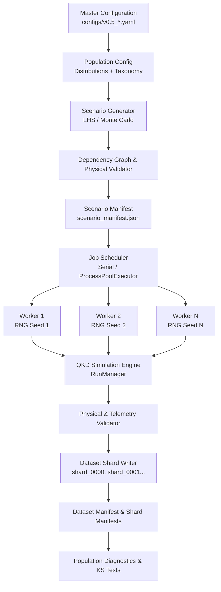

# QISM — Quantum Infrastructure Security Monitor

**Anomaly-Based ML QKD Attack Prevention — physics-informed stochastic telemetry simulator (V0.6)**

QISM is a research infrastructure project: a physics-informed, stochastic, event-level
telemetry generator for quantum-key-distribution (QKD) implementations. Its purpose is to
produce realistic operational telemetry — including attack-induced physical deviations — that
can be used to develop and evaluate **anomaly-detection systems that learn legitimate QKD
operational behaviour and detect both known and previously unseen attacks**.

The simulator is **not** merely an educational BB84 simulator. It is built to become a
dataset-generation engine for ML-based QISM anomaly detection.
- **Version 0.1** implemented the core decoy-state BB84 stochastic event simulator.
- **Version 0.2** added detector realism (READY/DEAD state machine, nonparalyzable dead time,
  rate-dependent dead time, exponential afterpulsing, and detector dynamics telemetry).
- **Version 0.3** added the **Attack-Aware QKD Simulation Engine**: 6 causal physical attack models,
  a 5-phase attack lifecycle with onset/recovery profiles, multi-attack episodes, zero-leakage
  observable vs ground-truth telemetry separation, attack and generalization dataset generators,
  and an attack validation suite with diagnostic figures (14–20).
- **Version 0.4** introduced **Enhanced Physical Realism & Infrastructure Telemetry**:
  continuous-time environmental drift (Ornstein–Uhlenbeck processes and diurnal thermal cycles),
  coupled physical phenomena (temperature-dependent dark counts and quantum efficiency, source jitter
  and drift, dynamic channel attenuation, polarization misalignment drift, local clock drift and
  timing offset, stray ambient background optical flux), a realistic multi-rate infrastructure sensor
  suite (finite ADC quantization, Gaussian noise, stochastic missingness), strict observable vs
  ground-truth telemetry separation, causal attack composition on drifting baselines, and complete
  checkpoint serialization.
- **Version 0.5** introduced **Large-Scale Scenario Generation, Population Diversity & Scalable Dataset Infrastructure**:
  formal scenario and population abstractions (`Scenario`, `PopulationConfig`, `ScenarioGenerator`),
  stratified parameter distributions (Uniform, Normal, Truncated Normal, Log-Normal, Beta, Categorical)
  with Latin Hypercube Sampling, causal parameter dependency resolution (distance-to-loss scaling,
  detector pair fabrication mismatch, decoy hierarchy, stress regimes), a 5-tier deterministic seed
  hierarchy with domain isolation, a scalable parallel batch execution scheduler (`JobScheduler`,
  `ProcessPoolExecutor`) with independent worker RNGs and deterministic serial/parallel equivalence,
  fault-tolerant atomic checkpointing and resume without duplicate execution, memory-bounded sharded
  dataset streaming (`DatasetShardWriter`, `shard_manifest.json`, `dataset_manifest.json`), scenario-level
  data partition isolation preventing train/generalization leakage, automated statistical goodness-of-fit
  diagnostics (Kolmogorov–Smirnov tests), and full CLI integration.
- **Version 0.6 (this release)** introduces **Anomaly Detection, ML Benchmarking & Security Evaluation**:
  formal one-class / unsupervised anomaly detection framework trained strictly on normal telemetry,
  dedicated feature extraction and causal temporal feature engineering ($x_{\le t}$), robust preprocessing
  pipelines fit strictly on training splits, standard and robust statistical baselines (Mahalanobis distance,
  Minimum Covariance Determinant), classical machine learning detectors (Isolation Forest, One-Class SVM, Local
  Outlier Factor), compact neural reconstruction baselines (PyTorch Dense Autoencoder, Sequence-to-Sequence
  LSTM Temporal Autoencoder), normal-only threshold calibration ($\tau = Q_{1-\alpha}(S_{\text{val\_normal}})$),
  operational alarm state machines (`NORMAL`, `SUSPECT`, `ALARM`) with persistence and hysteresis,
  comprehensive evaluation metrics (FPR, FNR, Specificity, AUROC, AUPRC, detection delay, false alarms per hour),
  out-of-distribution (OOD) generalization evaluation across held-out hardware and environmental regimes,
  feature ablation studies (QKD-only, detector-only, environmental-only, infrastructure-only, full),
  rigorous ground-truth leakage audits, automated sanity diagnostics (label shuffling, random features),
  deterministic experiment manifests, and end-to-end CLI integration.

---

## 1. What QISM is and why it exists

QKD systems (e.g. decoy-state BB84) are threatened by implementation attacks that exploit
real hardware behaviour — detector efficiency mismatch, timing shifts, blinding, and so on.
Detecting such attacks requires monitoring the *physical operating point* of the system:
gains, QBER, timing statistics, detector imbalance, decoy-state residuals.

To train an anomaly detector you need large quantities of *labelled* data:

- **normal** operational telemetry (legitimate behaviour, including its natural variation),
- **calibration** data that validates the simulator against its analytical model,
- **attack** telemetry (V0.3) with ground-truth labels and zero leakage,
- **generalization** data (V0.3) covering held-out attacks, severities, and novel regimes.

This simulator generates that data from a Monte Carlo model of the physical/event process —
never by directly manipulating features. Detectors are stateful (dead time, recovery, afterpulsing),
and attacks operate strictly by perturbing physical variables (channel loss, mean photon numbers,
detector efficiencies, timing offsets, state interception).

## 2. The primary design principle

**Attacks and physical effects are modelled at the underlying physical/event level.**

```
Physical parameters
        ↓
Alice/source → photon generation → quantum channel → [physical attack transform]
        → Bob receiver → detector process → detection events → raw telemetry
        → window aggregation → physics-informed features → dataset → future detector
```

An intercept-resend attack measures in Eve's basis and emits new physical pulses. A channel loss attack
attenuates optical transmittance. A source manipulation attack alters emitted photon statistics. A detector
manipulation attack perturbs SPAD quantum efficiency. A timing attack shifts pulse arrival offsets. A PNS
attack splits multi-photon pulses and suppresses single-photon pulses.

**No attack ever does `timing_feature += 20` or `qber = 0.25`** — telemetry must emerge naturally
from the underlying event simulation.

## 3. Version roadmap

| Version | Scope |
|---|---|
| 0.1 | Core decoy-state BB84 event simulator, event/window telemetry, physics-informed features, deterministic reproducible runs, calibration + normal datasets, manifests, checkpointing/crash recovery, analytical validation |
| 0.2 | Detector realism: dead time, READY/DEAD state machine, nonparalyzable recovery, rate-dependent effective dead time, afterpulsing, busy fraction, inter-arrival statistics, detector-state/recovery telemetry, analytical detector validation, V0.1-compatibility mode |
| 0.3 | Attack-aware QKD simulation: 6 causal physical attack models (intercept-resend, channel loss, source manipulation, detector manipulation, timing shift, PNS), 5-phase attack lifecycle (`NORMAL`, `ONSET`, `ACTIVE`, `TERMINATION`, `RECOVERY`), multi-attack episodes, zero label leakage guarantee, attack & generalization dataset generators, full validation suite & signatures report (Figures 14–20) |
| 0.4 | Enhanced physical realism & infrastructure telemetry: Ornstein–Uhlenbeck continuous drift + diurnal cycles, temperature-dependent dark counts & SPAD efficiency, source intensity jitter & drift, dynamic channel attenuation, polarization misalignment drift, receiver clock drift & timing offsets, stray ambient background flux, multi-rate sensor suite (noise, quantization, missingness), attack composition on dynamic baselines, 6 controlled physical validation experiments, correlation & time-series diagnostic suites |
| 0.5 | Large-scale scenario generation, population diversity, scalable parallel batch execution, dataset engineering: formal scenario & population abstractions, parameter distributions (Uniform, Normal, Truncated Normal, Log-Normal, Beta, Categorical) with LHS sampling, causal parameter dependency resolution, 5-tier deterministic seed hierarchy, fault-tolerant ProcessPoolExecutor, atomic sharded dataset streaming, scenario-level data partitioning, and zero-leakage validation |
| **0.6 (this release)** | ML/anomaly-detection benchmarking: unsupervised anomaly detectors (Isolation Forests, One-Class SVMs, LOF, Mahalanobis, Robust Covariance, Autoencoders, Temporal Sequence-to-Sequence Autoencoders), feature engineering, zero-leakage causal temporal representation, normal-only calibration, alarm state machines, out-of-distribution generalization evaluation, and automated sanity testing |
| 0.7 | Advanced temporal / streaming detection, continuous online inference, concept-drift handling, adaptive retraining |


The architecture, APIs, configuration schema, event/telemetry schemas, detector abstraction,
attack abstraction, and module boundaries are all designed so that 0.2–0.6 slot in without
rewrites.

---

## 4. Installation

### 4.1 Python 3.10 (required)

QISM targets **Python 3.10.x only**. Every CLI entry point verifies the interpreter version
and refuses to run otherwise. Do not use 3.11+, and do not use 3.9.

```bash
python3.10 --version        # Linux/macOS
py -3.10 --version          # Windows
```

### 4.2 Create the virtual environment

```bash
# Linux/macOS
python3.10 -m venv .venv
source .venv/bin/activate

# Windows PowerShell
py -3.10 -m venv .venv
.venv\Scripts\Activate.ps1

# Windows CMD
py -3.10 -m venv .venv
.venv\Scripts\activate.bat
```

### 4.3 Install dependencies

All dependencies are installed **inside** the virtual environment:

```bash
pip install -r requirements.txt          # runtime
pip install -r requirements-dev.txt      # + pytest, ruff, jupyter (optional)
# or, equivalently:
pip install -e .[dev]
```

Runtime dependencies (Python-3.10-compatible ranges): `numpy`, `scipy`, `pandas`,
`pydantic`, `pyyaml`, `pyarrow`, `tqdm`, `matplotlib`. Development: `pytest`, `ruff`,
optional `jupyter`/`ipykernel`.

No TensorFlow, PyTorch, Qiskit, or NetSquid in V0.2. The simulator is a custom Monte Carlo
event simulator.

## 5. Quick start

```bash
# 10,000-pulse smoke test (default config)
python scripts/run_simulation.py --config configs/default.yaml --pulses 10000

# Full default run (100,000 pulses)
python scripts/run_simulation.py --config configs/default.yaml

# Calibration dataset (parameter sweeps, 37 runs by default)
python scripts/generate_calibration.py --config configs/calibration.yaml

# Normal operational dataset (100 runs x 100,000 pulses by default)
python scripts/generate_normal.py --config configs/normal.yaml

# Small normal dataset for development
python scripts/generate_normal.py --runs 5 --pulses 10000

# Inspect a generated run
python scripts/inspect_dataset.py --path data/normal/run_0000

# Run the analytical validation suite (figures + report)
python scripts/run_validation.py --config configs/default.yaml --pulses 200000

# Run the test suite
python -m pytest
```

## 6. Project layout

```
qism-simulator/
├── README.md  LICENSE  requirements.txt  requirements-dev.txt  pyproject.toml  .gitignore
├── configs/
│   ├── default.yaml  calibration.yaml  normal.yaml
│   └── future/                     # V0.2+ templates (v02 is loadable; V0.3+ placeholders)
│       ├── v02_detector.yaml  v03_environment.yaml
│       ├── v04_attacks.yaml   v05_advanced_attacks.yaml
├── src/qism/
│   ├── __init__.py   config.py   random.py   types.py   units.py
│   ├── source/      Alice, decoy-state source, WCP photon source
│   ├── channel/     loss, polarization, timing
│   ├── receiver/    Bob, basis selector, PBS routing
│   ├── detector/    SPAD model + READY/DEAD state machine, dead time,
│   │                afterpulse queue, dark counts, timing/gate, probe
│   ├── attacks/     base interface (disabled pass-through in V0.2)
│   ├── environment/ Environment abstraction + StableEnvironment
│   ├── telemetry/   event schema, window features, window aggregator
│   ├── simulation/  chunked simulator, checkpoint manager, run manager
│   ├── datasets/    calibration/normal generators, Parquet writer, manifests
│   └── validation/  analytical relations, statistics, plots
├── scripts/         run_simulation / generate_calibration / generate_normal /
│                    inspect_dataset / run_validation
├── tests/           test_config, _source, _channel, _detector, _telemetry,
│                    _statistics, _reproducibility, _checkpointing, _v01_regression
├── data/            calibration/ normal/ attacks/ generalization/   (generated)
├── checkpoints/     per-run checkpoint.json + rng_state.npz           (generated)
├── logs/            timestamped CLI logs                              (generated)
└── reports/         figures/ validation/                              (generated)
```

## 7. Mathematical model (V0.1 core + V0.2 detector dynamics)

### 7.1 Protocol

Decoy-state BB84. Repetition rate `f_rep = 1 MHz` by default, so `T_rep = 1 µs`. Arbitrary
pulse counts are supported (`--pulses`).

### 7.2 Source

- Alice bits: `P(A=0) = P(A=1) = 0.5`.
- Alice bases: `P(Z) = P(X) = 0.5`. Polarization mapping: `Z0=H, Z1=V, X0=D, X1=A`.
- Intensity classes: `P(signal)=0.80, P(decoy)=0.15, P(vacuum)=0.05` (sums to 1), with
  mean photon numbers `µ_s = 0.5, µ_d = 0.1, µ_v = 0.0` (all configurable).

### 7.3 Weak coherent pulse photon statistics

Photon number per pulse is sampled explicitly:

$$P(N_\gamma = n) = \frac{e^{-\mu}\,\mu^n}{n!}, \qquad
P_0 = e^{-\mu},\quad P_1 = \mu e^{-\mu},\quad P_{\ge 2} = 1 - e^{-\mu}(1+\mu)$$

(computed with numerically stable forms, e.g. `-expm1(-µ) - P1`). The simulator **never
forces single-photon behaviour**; the full photon-number distribution is preserved because
future PNS attacks and decoy-state analysis depend on it.

### 7.4 Channel

$$L_{\text{total}} = \alpha L + L_{\text{sys}}, \qquad
\eta_{\text{ch}} = 10^{-L_{\text{total}}/10}$$

Default `L = 25 km`, `α = 0.20 dB/km`, `L_sys = 1.0 dB` → `η_ch ≈ 0.2512`. Each emitted
photon is transmitted independently with probability `η_ch` (binomial attenuation);
equivalently, photons arriving at Bob follow `Poisson(µ·η_ch)`. The **source** photon number
is preserved as hidden ground truth in the event record.

Propagation delay: `t_channel = n_eff·L/c` with `n_eff = 1.468`, `c = 299792458 m/s`
(defaults, both configurable). The simulator distinguishes pulse timestamp, channel delay,
expected arrival, and measured arrival.

### 7.5 Polarization misalignment

$$p_{\text{mis}} = \sin^2(\theta) \quad (\theta \text{ in radians})$$

Same basis: the signal lands on Alice's detector with probability `1 - p_mis` and the
opposite detector with `p_mis`. Different bases: uniformly random outcome (ideal BB84
measurement before detector imperfections).

### 7.6 Detector model (two-detector Bob)

Bob has **two independent `Detector` objects** (D0, D1) — never a single detection
probability. For `n` photons arriving at a detector with efficiency `η_d`:

$$P(\text{signal click}) = 1 - (1-\eta_d)^n$$

Dark counts (per detector, over the detection interval `Δt` — default the gate width):

$$P_{\text{dark}} = 1 - e^{-\lambda_{\text{dark}}\,\Delta t} \approx \lambda_{\text{dark}}\,\Delta t$$

Default `λ_dark = 1000 Hz`, `η_d = 0.15` for both detectors. Signal and dark processes are
independent and combined without double counting: `p_click = 1 - (1-p_sig)(1-p_dark)`, and the
event record preserves the click *source* (`signal`, `dark`, `signal+dark`).

### 7.7 Timing

- Signal arrivals: `t_arr = t_expected + ε`, `ε ~ Normal(0, σ_t²)`, default `σ_t = 50 ps`.
- Gate: width `W = 1 ns` centred on the expected arrival; accepted iff
  `|t_arr - t_expected| ≤ W/2`.
- Dark arrivals: uniform inside the gate (dark counts are uniform in time; the detector
  only integrates during the gate). Gate logic lives in `qism/detector/timing.py` so future
  time-shift/after-gate attacks modify timing without touching detector code.

### 7.8 Dead time, recovery and afterpulsing (V0.2)

V0.2 makes the detector explicitly **stateful**. Every accepted avalanche renders the
detector DEAD until `t + tau_eff`; the state machine is

```
READY --accepted avalanche--> DEAD --t >= dead_until--> READY
```

**Nonparalyzable dead time (default):** a candidate arriving during the dead interval is
lost (`loss_reason = "dead_time"`) and **never** extends the dead period or resets
`last_click_time`. Events arriving during dead time are kept in telemetry as dead-time
losses — they are valuable monitoring data, not deleted. The dead interval is local to each
detector: a click in D0 never puts D1 into dead time.

**Recovery model (`hard_dead_time`):** the detector is completely unavailable during the
dead interval and returns to READY exactly at `t + tau_eff`. Gradual/exponential recovery
functions are reserved for later versions (the API already separates state, `dead_until`,
`last_click_time`, and `time_until_recovery`).

**Afterpulsing (exponential, parent-only):** after each *primary* avalanche, an afterpulse
occurs with probability `p_AP` and its delay is drawn from

$$f_{AP}(\Delta t) = \frac{1}{\tau_{AP}} e^{-\Delta t/\tau_{AP}}, \qquad \Delta t \ge 0$$

The afterpulse becomes a future candidate event processed chronologically through the same
detector state machine — if the detector is still DEAD when it arrives, it is lost.
Afterpulses never generate second-generation afterpulses in V0.2 (`parent = primary
avalanche` only). Because the detector is a **gated** SPAD, an afterpulse that falls between
gates is suppressed (the detector is not biased); this emerges from the event simulation,
not from a feature tweak.

**Rate-dependent effective dead time (default model `rate_dependent`):**

$$\tau_{\text{eff}}(\lambda) = \tau_0 + \Delta\tau \, \frac{\lambda}{\lambda + \lambda_c}$$

with defaults `tau_0 = 50 ns`, `delta_tau = 50 ns`, `lambda_c = 1 MHz` (so `tau_eff -> 100 ns`
at high rate). `lambda` is the per-detector **candidate**-event rate estimated over the
previous `rate_estimation_window_pulses` (default 10,000) — never from accepted clicks
alone, which would bias the model. The `fixed` model uses `tau_dead_s` directly. The README
uses the following vocabulary: *physical dead time* is the detector's intrinsic recovery
parameter; *effective dead time* is what the simulation applies per avalanche (possibly
rate-dependent); *recovery model* describes how the detector returns to READY.

### 7.9 Double clicks

Possible outcomes: `NONE, D0, D1, DOUBLE`. Double clicks are **retained in telemetry**
(never silently discarded). Sifted-key policy (configurable, default `exclude`): double
clicks are excluded from the sifted key / QBER, but their count stays in telemetry. With
V0.2 dead time, a double click requires *both* detectors to be READY in the same gate — dead
time can therefore change the double-click rate, and this is reflected in the events
naturally.

### 7.10 Sifting and QBER

`sifted = (B_A == B_B)`. For accepted single-click sifted events,
`bit_error = (A_bit != measured_bit)`. With the V0.1 policy:

$$QBER = \frac{N_{\text{errors}}}{N_{\text{sifted}}}, \qquad
QBER_Z,\; QBER_X \text{ computed separately}$$

**NaN** (never 0) when the denominator is zero.

### 7.11 Gain and yields

$$Q_I = \frac{N_{\text{click},I}}{N_{\text{sent},I}} \quad (I \in \{\text{signal, decoy, vacuum}\})$$

Empirical yields (simulator ground truth, since we know the sampled photon number):

$$Y_n = \frac{N_{\text{click}|n}}{N_{\text{sent}|n}}, \qquad n = 0\ldots n_{\max}\ (\text{default }10)$$

Photon number is **hidden ground truth**: it is recorded for validation but excluded from ML
inputs — a deployed system would not know it.

### 7.12 Decoy residual

$$Q_{\mu}^{\text{pred}} = \sum_{n=0}^{n_{\max}} \frac{e^{-\mu}\,\mu^n}{n!}\,Y_n, \qquad
R = Q_{\mu}^{\text{obs}} - Q_{\mu}^{\text{pred}}$$

V0.1 uses this as an API/feature placeholder for future decoy-state security estimators.

## 8. Event-level telemetry schema

Every pulse produces one row in `events.parquet`. Columns (56) are tagged with a
`FieldCategory` — `OBSERVABLE_TELEMETRY`, `DERIVED_TELEMETRY`, `SIMULATOR_GROUND_TRUTH`,
`FUTURE_ONLY` — so ground-truth fields can never leak into ML inputs.

V0.1 key fields: `run_id, scenario_id, window_id, pulse_id, timestamp, alice_bit,
alice_basis, intensity_class, mu, photon_number*, channel_transmittance*, channel_delay_s*,
polarization_misalignment*, bob_basis, detector_0_click, detector_1_click, double_click,
click_type, detector_id, expected_arrival_time_s, arrival_time_s, timing_offset_s,
gate_width_s, detector_efficiency*, dark_count_rate*, detector_state, sifted, bit_error`,
plus future-only fields (`attack_active=False, attack_type="none", attack_strength=0,
attack_id=null, environment_state="stable", temperature/bias/power/recovery = null`).
`*` = simulator ground truth.

**V0.2 detector-dynamics fields** (filled by the stateful engine; neutral defaults in
V0.1-compatibility mode so the schema is identical):

- **Observable:** `detector_0_state / detector_1_state` (`ready`/`dead` before the pulse's
  candidates), `detector_0/1_dead_time_remaining_s`, `detector_0/1_arrival_time_s`.
- **Derived:** `detector_0/1_time_since_last_click_s`, `detector_0/1_dead_duration_s`
  (per-avalanche effective dead time), `dead_time_loss` (a candidate was rejected because a
detector was DEAD).
- **Ground truth (SIMULATOR_GROUND_TRUTH — excluded from ML inputs):**
  `detector_0/1_candidate_count`, `detector_0/1_dead_rejected_count`, `afterpulse_candidate`,
  `afterpulse_detected`, `afterpulse_parent_pulse_id`, `afterpulse_delay_s`. A real
  deployed monitor generally **cannot** label an individual click as an afterpulse without
detector-internal information; these fields exist for simulator diagnostics and validation
only.

Click types gained the afterpulse members (`d0_afterpulse`, `d0_signal_afterpulse`, …)
whose origin resolution is documented in `qism.types.ClickType` and
`qism.simulation.simulator._click_type_label` (chronologically-first avalanche wins within
a gate; a candidate arriving while the detector is DEAD is recorded as dead-time loss).

Units are SI: seconds, metres, Hz, radians (angles are configured in degrees and converted).

## 9. Window telemetry and physics-informed features

Events are partitioned by **pulse ID** into fixed windows (default 10,000 pulses), not by
detected-event count — QKD systems experience loss. Each window produces one row in
`telemetry.parquet` with:

- **Protocol:** `qber, qber_z, qber_x, sifted_count, sifted_rate, error_count`
- **Gain:** `signal_gain, decoy_gain, vacuum_gain`
- **Decoy:** `signal_decoy_residual, decoy_decoy_residual, vacuum_residual`
- **Detector:** `detector_0_count, detector_1_count, total_count, detector_imbalance,
  double_click_rate, dark_count_rate`
- **Timing:** `mean/std_arrival_offset, timing_skewness, timing_kurtosis` (excess/Fisher
  kurtosis, population moments) plus a configurable timing histogram derived from raw events
- **Photon statistics (ground truth):** `mean_photon_number, photon_variance,
  vacuum/single/multiphoton_fraction`
- **Channel:** `mean_channel_transmittance`
- **Reconstruction counts:** `n_pulses, n_signal, n_decoy, n_vacuum, n_sifted_z/x,
  n_errors_z/x, n_double, n_detection, n_dark_0/1, yield_0..yield_n_max`

Conventions (documented in `qism/telemetry/features.py`):
- `detector_i_count` counts events where detector i clicked (doubles count for both);
  `N_detection = C0 + C1 - N_double`; `double_click_rate = N_double / N_detection`.
- `detector_imbalance = (C0 - C1)/(C0 + C1)`; **NaN** when `C0 + C1 = 0`.
- QBER uses sifted single-click events only (double clicks excluded by policy).

**V0.2 detector-dynamics features** (all derived from the event records, never fabricated):

- **Loss rates:** `dead_time_loss_rate = N_dead_rejected / N_candidate` (NaN when there
  were no candidates — never silently 0), `candidate_event_rate`, `accepted_event_rate`,
  `observed_click_rate` (a.k.a. `count_rate`), all per window over `T_obs = n_pulses/f_rep`.
- **Utilization:** `detector_0/1_busy_fraction = busy_time / T_obs` (exact interval-union of
  the per-avalanche dead intervals), `detector_0/1_ready_fraction = 1 - busy_fraction`,
  `detector_0/1_dead_fraction = busy_fraction`. `U_ready + U_dead ≈ 1` (boundary effects
  only). This is detector *utilization*, distinct from optical detection efficiency.
- **Inter-arrival statistics:** `detector_0/1_mean/std/p01/p05/p50/p95/p99_interarrival`
  computed from the actual per-detector accepted-click times plus configurable inter-arrival
  histograms (`linear` or `log` spacing, 30 bins default) that reveal the dead-time cutoff.
- **Effective dead time:** `effective_dead_time` = mean tau_eff applied to the window's
  avalanches.
- **Click-process statistics:** `fano_factor` (Var/mean of the per-sub-bin combined click
  count; Poisson baseline = 1) and `autocorr_lag1..5` (Pearson autocorrelation of the
  per-pulse click indicator series).
- **Afterpulse ground truth:** `afterpulse_rate_ground_truth` (detected afterpulses /
  primary avalanches) and `mean_afterpulse_delay`. **SIMULATOR GROUND TRUTH — must never be
  used as an ML input**; aggregated into observable proxies only if a future monitor could
  actually measure them.
- **Reconstruction counts:** `n_candidate_0/1`, `n_dead_rejected_0/1`,
  `n_afterpulse_detected`, `n_primary_avalanches`.

## 10. Event queue and chronological processing (V0.2)

V0.2 introduces an event queue because afterpulses occur *after* their parent avalanche.
Each detector owns a priority queue (`heapq`-style sorted list) of pending afterpulse
candidates with `(time, kind, parent_pulse_id, delay)`. Candidates — signal, dark,
afterpulse — are processed **chronologically** inside each pulse gate; within a gate,
ties are resolved by a deterministic kind ranking (`afterpulse < dark < signal`), so event
ordering never depends on dictionary iteration or floating-point coincidence. The queue is
part of the detector's physical state: it survives pulses, chunks, telemetry windows and
checkpoints (serialized in `runtime_state`), so resuming a run never loses or duplicates a
pending afterpulse.

The causal chain implemented per candidate (spec §10):

```
arrival time -> detector availability -> (DEAD? reject as dead_time_loss)
-> signal/dark/afterpulse response -> avalanche -> dead time -> possible afterpulse -> queue
```

Every detector signature (dead-time suppression, afterpulse clustering, busy fraction,
inter-arrival cutoff) **emerges from this event process** — no feature is ever modified
directly.

## 11. Random seeds and reproducibility

- All randomness comes from `numpy.random.Generator(PCG64(seed))` — never `random.random()`.
- Per-run seed: `run_seed = splitmix64(master_seed, run_id)` (deterministic, one-way).
- Per-chunk RNG: `make_chunk_rng(run_seed, chunk_index)`.
- Chunks are **always simulated at full size** (`n = chunk_size`) and truncated at write
  time, so chunk RNG streams are invariant to run length — this is what makes mid-chunk
  crash recovery exact.
- A run with the same simulator version, config, and seed produces statistically identical
  output; with deterministic serialization, bit-identical event records.

## 12. Checkpointing and crash recovery

The simulator checkpoints periodically (default every 10,000 pulses) and recovers from
interrupted runs. **No events are duplicated or lost.**

Design:

1. Chunk files (`chunks/events_*.parquet`) are the **authoritative** record of completed
   pulses; each is written atomically (`.tmp` → fsync → rename).
2. **V0.2:** the checkpoint additionally serializes the simulator's *physical* runtime
   state — each detector's state machine (`state`, `dead_until`, `last_click_time`,
   counters), the pending afterpulse queues, and the open rate-estimation window — so a
   resumed run continues the detector physics exactly, never re-initializing detectors at a
   chunk boundary.
3. `checkpoint.json` + `rng_state.npz` are written atomically too; the previous valid
   checkpoint is preserved as `.bak`, so a corrupt checkpoint falls back to the previous one.
4. On restart the checkpoint is validated against simulator version, configuration hash,
   run id, and seed; then the committed pulse count is recomputed from the chunk files. If
   the checkpoint's stored detector state lags the committed files (crash before the next
   scheduled save), the missing chunks are **replayed** deterministically to rebuild the
   exact physical state — bounded by the checkpoint interval.
5. If the committed events end **mid-chunk**, that one chunk is re-simulated at full size —
   the deterministic chunk RNG and the restored detector state reproduce the committed
   prefix bit-identically (verified with a frame-equality check), and the chunk file is
   repaired. Work is bounded to one chunk, never proportional to run length.
6. Telemetry is a pure function of events, so it is rebuilt from the committed chunk files
   on resume.
7. Completed runs are marked explicitly (`manifest.json` status `COMPLETED`); resuming a
   completed run is a no-op, and `--fresh` discards everything deliberately.

```bash
# interrupt/resume
python scripts/run_simulation.py --config configs/default.yaml --pulses 100000   # starts...
# ...crash or Ctrl+C...
python scripts/run_simulation.py --config configs/default.yaml --resume          # resumes exactly

# deliberately restart from scratch
python scripts/run_simulation.py --config configs/default.yaml --fresh
```

Extending a run (e.g. 5,000 → 100,000 pulses) with `--resume` is supported: run length
(`protocol.n_pulses`) is deliberately excluded from the configuration hash because it is a
run-control parameter, not a physics parameter.

## 13. Datasets

Each run directory contains:

```
events.parquet     # one row per pulse (56 columns, V0.2 schema)
telemetry.parquet  # one row per window (features + counts)
manifest.json      # full provenance
config.yaml        # the exact effective configuration
README.md          # dataset summary
chunks/            # per-chunk parquet (retained as the resume cursor)
```

`manifest.json` records: dataset version, simulator version, timestamp, run id, scenario,
family, seeds, pulse counts, window size, configuration hash, git commit (if available),
Python + package versions, status (`CREATED/RUNNING/CHECKPOINTED/COMPLETED/FAILED/INTERRUPTED`),
and (for calibration) `varied_parameter` / `varied_value`.

Data-quality checks run before a dataset is marked COMPLETED: expected row count, contiguous
unique pulse ids, valid classes/click types, values in range, no NaN where NaN is not
allowed, strictly increasing timestamps, correct window bookkeeping, manifest consistency.
Any failure marks the dataset `FAILED` (never silently complete).

### Calibration dataset (`configs/calibration.yaml`, 37 runs)

One parameter varied per run, everything else fixed (default 50,000 pulses/run):
distance `{0,5,10,25,50} km`, attenuation `{0.10…0.30} dB/km`, `µ_signal {0.1…0.7}`,
`µ_decoy {0.05,0.10,0.15}`, detector efficiency `{0.05…0.30}`, dark rate `{100…5000} Hz`,
misalignment `{0…3}°`, timing jitter `{10…200} ps`. Calibration data validates the simulator
against its analytical model and must **not** be mixed into ML training.

### Normal dataset (`configs/normal.yaml`, default 100 runs × 100,000 pulses)

Legitimate operational data at the default operating point; each run uses a unique
deterministic seed derived from `(master_seed, run_id)`. Use
`--runs 5 --pulses 10000` for development.

### Attacks / generalization directories

Placeholders with READMEs; attack generation begins in V0.4, generalization evaluation in V0.6.

## 14. CLI reference

```
run_simulation.py      --config CFG [--pulses N] [--runs N] [--seed N] [--run-id ID]
                       [--scenario S] [--output-dir D] [--checkpoint-dir D]
                       [--resume] [--fresh] [--summary PATH]
generate_calibration.py --config CFG [--pulses N] [--seed N] [--only label...]
                       [--output-dir D] [--checkpoint-dir D] [--resume] [--fresh]
generate_normal.py     --config CFG [--runs N] [--pulses N] [--seed N] [--start-index I]
                       [--output-dir D] [--checkpoint-dir D] [--resume] [--fresh]
inspect_dataset.py     --path RUN_DIR [--events-head N]
run_validation.py      --config CFG [--pulses N] [--seed N] [--outdir D]
```

All scripts verify Python 3.10 and log to `logs/` as well as the console.

## 15. Tests and validation

`python -m pytest` runs the full suite covering:

- **V0.1 regression:** Poisson photon statistics, basis/bit/intensity statistics, exact
  channel attenuation and misalignment formulas, detector efficiency / dark count / timing
  jitter / symmetry, event schema and ground-truth separation, window features
  (QBER/gains/imbalance/residual conventions), analytical relations (coherent-state gain,
  vacuum gain, yields, decoy residual), reproducibility (same seed → identical output),
  checkpoint recovery, and the dedicated `test_v01_regression.py` (legacy config reproduces
  the V0.1 baseline gain/QBER and emits neutral V0.2 columns; dynamics are a small
  perturbation at the default operating point).
- **V0.2 detector dynamics:** READY→DEAD→READY transitions and recovery, the
  nonparalyzable property (dead candidates never extend the dead interval), afterpulse
  scheduling with exponential delays, afterpulse loss during dead time, rate-dependent
  `tau_eff(lambda)`, busy fraction from state intervals, stateful-engine telemetry,
  dead-time count suppression (tau > T_rep), and stateful checkpoint/recovery (interrupt +
  resume with dynamics enabled is bit-identical to a clean run; mid-chunk repair;
  checkpoint contains detector runtime state).
- **V0.2 analytical validation:** `r_obs = lambda/(1+lambda*tau)`, `E[dt] = tau + 1/lambda`,
  `std(dt) = 1/lambda`, the inter-arrival dead-time cutoff, exponential afterpulse delays,
  inferred rate-dependent tau_eff, busy fraction = N·tau/T, and sanity of the stateful
  window features (Fano ≈ 1, autocorrelation ≈ 0, busy/ready fractions summing to 1).

`python scripts/run_validation.py` produces **13 baseline figures** under `reports/figures/` plus
`reports/validation_report.md` / `validation_summary.json`:

1. Poisson photon-number distribution vs theory
2. Channel transmittance vs distance
3. Signal gain vs detector efficiency
4. Vacuum gain vs dark-count rate (measured at `Δt = 100 ns`; see §19)
5. Timing distribution vs Gaussian jitter
6. Detector imbalance distribution (centred at 0 for symmetric detectors)
7. QBER vs polarization misalignment (matches `sin²θ`)
8. Signal / decoy / vacuum gains vs theory
9. Nonparalyzable dead-time rate suppression (`r_obs` vs `lambda/(1+lambda·tau)`)
10. Inter-arrival distribution with the dead-time cutoff (min gap ≥ tau)
11. Afterpulse delay distribution vs `Exp(tau_AP)`
12. Rate-dependent effective dead time vs theory
13. QKD-engine window features (dead-time loss, busy fraction, inter-arrival histogram)

`python scripts/run_attack_validation.py` produces **7 attack validation figures** (14–20) plus
`reports/attack_signatures.md`:

14. Intercept-Resend attack: QBER elevation across onset, active, and recovery phases
15. Channel Loss attack: Signal and decoy gain attenuation under variable optical attenuation
16. Source Manipulation attack: Detection rate and signal gain response to mean photon number perturbation
17. Detector Manipulation attack: Detector click imbalance skewing under single-detector efficiency blinding
18. Timing attack: Arrival time displacement and gate edge clipping effects
19. PNS attack: Decoy-state yield and gain ratio anomalies under multi-photon siphoning
20. Multi-attack progression: Sequential, distinct attack episodes in a single continuous operational run

All figures have titles, axis labels with units, legends, and grids; saved as PNGs under `reports/figures/`.

## 16. Configuration

Every physical parameter is configured (Pydantic-validated YAML); the simulator contains no
scattered hard-coded constants (fundamental constants live in `qism/units.py` and are
mirrored in the config). Sections: `protocol, source, channel, background, receiver,
detectors, timing, environment, attack, telemetry, simulation, dataset`. The `environment`
and `attack` sections exist with disabled defaults so V0.3/V0.4 extend them cleanly.
Invalid values (probability > 1, negative efficiency/distance, intensities not summing to 1,
…) fail immediately with clear validation errors.

**V0.2 detector section** (nested, validated):

```yaml
detectors:
  detector_0: {label, efficiency, dark_count_rate_hz, timing_jitter_s}
  detector_1: {label, efficiency, dark_count_rate_hz, timing_jitter_s}
  dead_time:
    enabled: true                 # false -> V0.1 stateless model
    model: rate_dependent         # 'fixed' | 'rate_dependent'
    tau_dead_s: 50.0e-9           # nominal dead time (fixed model / baseline)
    recovery_model: hard_dead_time
    tau_0_s: 50.0e-9              # rate-dependent baseline
    delta_tau_s: 50.0e-9          # rate-dependent increment
    lambda_c_hz: 1.0e6            # characteristic rate
    rate_estimation_window_pulses: 10000
  afterpulse:
    enabled: true
    probability: 0.01             # P(afterpulse | primary avalanche)
    decay_model: exponential
    tau_afterpulse_s: 100.0e-9
  state:
    initial_state: ready
```

**V0.1 compatibility:** configuration files that use the legacy flat keys
(`detectors.dead_time_enabled`, `dead_time_s`, `afterpulse_enabled`, `p_afterpulse`,
`tau_afterpulse_s`) load unchanged — they are migrated onto the nested structure with
disabled semantics, so old V0.1 YAML reproduces V0.1 behaviour. The telemetry section adds
`interarrival_histogram_bins` (30), `interarrival_histogram_scale` (`linear`|`log`) and
`fano_sub_bins` (64).

## 17. Module guide

| Module | Responsibility |
|---|---|
| `config.py` | Pydantic configuration (all sections), config hash, load/override helpers, `load_attack_config`, `load_generalization_config` |
| `random.py` | PCG64-based RNG factory, splitmix64 seed derivation, per-chunk seeds, attack RNG isolation (`_DOMAIN_ATTACK`, `make_attack_rng`) |
| `types.py` | Enums: Basis, IntensityClass, DetectorState, ClickSource/ClickType, FieldCategory, AttackPhase, statuses |
| `units.py` | SI constants and human-readable unit parsing |
| `source/` | Alice (bits/bases), decoy-state classes, WCP Poisson photon source |
| `channel/` | Loss (`10^(-L/10)`), polarization (`sin²θ`), propagation timing |
| `receiver/` | Bob (two detectors), basis selector, PBS routing/ideal measurement |
| `detector/` | SPAD + READY/DEAD state machine, nonparalyzable dead time, afterpulse queue, rate-dependent tau_eff, busy-interval tracking, dark-count probability, gate/jitter logic, free-running validation probe |
| `attacks/` | `AttackEngine`, `BaseAttack`, `OnsetProfile`, `SystemIntervention`, `AttackScenario`, and 6 causal physical attacks (`InterceptResendAttack`, `ChannelLossAttack`, `SourceManipulationAttack`, `DetectorManipulationAttack`, `TimingAttack`, `PNSAttack`) |
| `environment/` | `Environment` abstraction + `StableEnvironment` |
| `telemetry/` | Event schema + categories, window features, window aggregator, zero-leakage observable vs ground-truth feature separation |
| `simulation/` | Chunked simulator, stateful attack application, `CheckpointManager`, `RunManager` (resume/finalize) |
| `datasets/` | Calibration, Normal, Attack, and Generalization generators, Parquet writer + quality checks, atomic manifests & completion markers |
| `validation/` | Analytical relations, empirical statistics, V0.1/V0.2/V0.3 plot and report generation |

---

## 18. Version 0.3: Attack-Aware Simulation Engine & Physical Attack Suite

Version 0.3 completes the transition of QISM into a fully attack-aware dataset generator for
machine learning anomaly detection.

### 18.1 Physics-Driven Attack Modeling Principle
Attacks never inject synthetic anomaly labels or overwrite high-level telemetry columns.
Every attack is an intervention in the physical simulation pipeline:
1. The **`AttackEngine`** evaluates the active attack phase and profile-driven amplitude $A(t) \in [0, 1]$.
2. The effective severity $s(t) = s_0 \cdot A(t)$ generates a **`SystemIntervention`** that directly perturbs
   physical variables: optical loss $\Delta L$, mean photon number $\Delta \mu$, detector efficiency $\Delta \eta$,
   dark count rate, arrival delay $\Delta t$, or photon routing/polarization.
3. Pulse simulation and detection proceed through the standard physical laws (Poisson photon emission,
   Beer-Lambert transmittance, PBS beam splitting, and SPAD avalanche generation).
4. Window-level telemetry features emerge causally from underlying physical events.

### 18.2 Six Causal Physical Attack Models

| Attack | Physical Mechanism | Primary Observable Signature |
|---|---|---|
| **Intercept-Resend (`InterceptResendAttack`)** | Eve measures Alice's pulses in a random basis ($B_E$) and resends a photon in the measured state $(B_E, b_E)$. | **QBER elevation** (+20% to +25% on sifted bits) with stable overall count rates. |
| **Channel Loss (`ChannelLossAttack`)** | Eve introduces extra attenuation ($\Delta L$ dB) via a variable optical attenuator. | **Signal and decoy gains drop** simultaneously; sifted count rate collapses. |
| **Source Manipulation (`SourceManipulationAttack`)** | Eve perturbs Alice's laser intensity ($\Delta\mu$). | **Detection rate and signal gain surge/drop**; multi-photon fraction shifts. |
| **Detector Manipulation (`DetectorManipulationAttack`)** | Eve blinds or degrades a specific SPAD or both ($\Delta\eta_i$, $\Delta\lambda_{\text{dark}}$). | **Strong detector imbalance skew** $\Delta_c = (C_0 - C_1)/(C_0 + C_1)$ and altered double-click rates. |
| **Timing (`TimingAttack`)** | Eve introduces sub-nanosecond propagation delays ($\Delta t$). | **Mean timing offset shifts**; gate-edge clipping induces apparent loss. |
| **PNS (`PNSAttack`)** | Eve measures multi-photon pulses ($n \ge 2$), splits a photon, and suppresses single-photon pulses ($n=1$). | **Decoy-state yield bounds violated**; dramatic anomaly in signal-to-decoy gain ratios. |

### 18.3 Five-Phase Attack Lifecycle
Real-world cyber-physical attacks do not switch on instantaneously. Every attack episode in QISM adheres
to a 5-phase ground truth lifecycle:
- **`NORMAL`**: Baseline legitimate operational conditions ($A(t) = 0$).
- **`ONSET`**: Progressive attack ramp ($0 \to 1$) over a configurable pulse duration using profiles:
  - `smoothstep`: $A(x) = 3x^2 - 2x^3$ (differentiable S-curve)
  - `linear`: $A(x) = x$
  - `exponential`: $A(x) = \frac{1 - e^{-3x}}{1 - e^{-3}}$
  - `instant`: $A(x) = 1$
- **`ACTIVE`**: Full attack intervention ($A(t) = 1$).
- **`TERMINATION`**: Progressive de-escalation ($1 \to 0$) over a configurable pulse duration.
- **`RECOVERY`**: Relaxation back to baseline operating conditions.

### 18.4 Zero Label Leakage Guarantee
To prevent machine learning models from learning spurious correlations or cheating during training:
- **Observable Columns**: 40+ physics-informed operational features (QBER, gains, counts, timing histograms,
  inter-arrival percentiles, Fano factor, autocorrelation) that a receiver would legitimately monitor.
- **Ground Truth Columns**: Prefixed with `ground_truth_` (`ground_truth_attack_active`, `ground_truth_attack_type`,
  `ground_truth_attack_phase`, `ground_truth_attack_fraction`, `ground_truth_mean_severity`, `ground_truth_attack_id`).
- Automated validation via `scripts/validate_dataset.py` and `tests/test_dataset_leakage.py` strictly asserts
  disjoint feature sets.

### 18.5 Dataset Families and CLI Tools

- **`generate_attacks.py`**:
  ```bash
  python scripts/generate_attacks.py --config configs/v0.3_attack.yaml
  ```
  Generates multi-run attack datasets across all 6 attack types with varying severities. Writes
  atomic `manifest.json` and `dataset_complete.marker` files.

- **`generate_generalization.py`**:
  ```bash
  python scripts/generate_generalization.py --config configs/v0.3_generalization.yaml
  ```
  Generates held-out attack types (PNS, Timing) and held-out severity levels (0.15, 0.85) to evaluate
  zero-shot transfer and out-of-distribution anomaly detection.

- **`validate_dataset.py`**:
  ```bash
  python scripts/validate_dataset.py data/attacks data/generalization --check-split
  ```
  Verifies dataset completeness markers, parquet schema consistency, zero label leakage, and disjoint
  train/test scenario splits.

- **`run_attack_validation.py`**:
  ```bash
  python scripts/run_attack_validation.py --pulses 60000
  ```
  Executes diagnostic simulations for all 6 attacks plus multi-attack progression episodes, generating
  Figures 14–20 and `reports/attack_signatures.md`.

---

## 19. Version 0.4: Enhanced Physical Realism & Infrastructure Telemetry

Version 0.4 introduces continuous-time non-ideal physical processes, environmental dynamics,
and realistic infrastructure telemetry. Real QKD systems operate in noisy environments subject
to diurnal temperature cycling, HVAC cycling, mechanical vibration, optical power variations,
and local clock drift.

### 19.1 Continuous-Time Environmental Processes

All continuous environmental dynamics are modelled using exact continuous-time Ornstein–Uhlenbeck (OU)
mean-reverting stochastic processes and diurnal harmonic cycles:

- **Exact OU Process:**
  $$X(t + \Delta t) = X(t) e^{-\theta \Delta t} + \mu (1 - e^{-\theta \Delta t}) + \sigma \sqrt{\frac{1 - e^{-2\theta \Delta t}}{2\theta}} Z_t, \quad Z_t \sim \mathcal{N}(0, 1)$$
  where $\theta$ is the mean-reversion rate, $\mu$ is the baseline mean, and $\sigma$ is the diffusion volatility.
- **Diurnal Thermal Cycle:**
  $$D(t) = A_{\text{diurnal}} \sin\left(\frac{2\pi t}{T_{\text{period}}} + \phi\right)$$
- **Physical Bounds:** Strictly clamped to valid physical domains $[X_{\min}, X_{\max}]$ (e.g. relative humidity $\in [0, 100]\%$, vibration $\ge 0\,\text{g}$, ambient light $\ge 0\,\text{lux}$).
- **State Serialization:** Full tuple serialization `(t, x, seed_seq)` enabling exact pause, checkpoint, and crash-recovery reproducibility.

### 19.2 Coupled Physical Phenomena

Dynamic environmental states continuously couple into QKD hardware components pulse-by-pulse:

1. **Temperature-Dependent SPAD Detectors:**
   $$\eta(T) = \max\left(0, \eta_0 \cdot \left[1 + \gamma_\eta (T - T_{\text{ref}})\right]\right)$$
   $$d(T) = \max\left(0, d_0 \cdot \left[1 + \gamma_d (T - T_{\text{ref}})\right]\right)$$
   where $\gamma_d \approx +0.03\,\text{K}^{-1}$ and $\gamma_\eta \approx -0.001\,\text{K}^{-1}$.
2. **Channel Loss Drift:**
   $$L_{\text{tot}}(t) = L_{\text{fiber}} + L_{\text{insertion}} + \Delta L_{\text{drift}}(t) \quad [\text{dB}]$$
   $$T_{\text{ch}}(t) = 10^{-L_{\text{tot}}(t) / 10}$$
3. **Polarization Misalignment Drift:**
   $$P_{\text{mis}}(t) = \sin^2\left(\theta_{\text{align}} + \Delta \theta_{\text{drift}}(t)\right)$$
4. **Source Intensity Jitter & Drift:**
   Pulse-to-pulse optical pump fluctuations $\mu_i = \mu_{\text{nominal}} (1 + \Delta \mu_{\text{drift}}(t)) (1 + \delta_i)$ with $\delta_i \sim \mathcal{N}(0, \sigma_{\text{jitter}}^2)$.
5. **Receiver Local Clock Drift & Timing Offset:**
   Clock phase wandering $\tau_{\text{offset}}(t)$ shifts observed photon arrival times:
   $$t_{\text{arr}} = t_{\text{exp}} + \tau_{\text{jitter}} + \tau_{\text{offset}}(t)$$
6. **Ambient Background Optical Flux:**
   Stray daylight/lighting leakage $R_{\text{bg}}(t) = R_{\text{base}} + \alpha_{\text{coupling}} L_{\text{ambient}}(t)$ produces in-gate optical noise clicks and dead-time blocking.

### 19.3 Multi-Rate Infrastructure Sensor Suite

The receiver environment is monitored by a suite of physical sensors modeled by `PhysicalSensor`:
- **Measurement Noise:** Additive Gaussian noise $\epsilon \sim \mathcal{N}(0, \sigma_{\text{noise}}^2)$.
- **Finite ADC Quantization:** Output rounded to discrete resolution steps: $y_q = \text{round}(y / q) \cdot q$.
- **Multi-Rate Subsampling:** Sensor hardware samples at low rates (e.g. 100 Hz – 1 kHz) while the quantum engine runs at 1 MHz – 10 MHz.
- **Sensor Missingness & Dropout:** Telemetry packet loss modeled as $M \sim \text{Bernoulli}(p_{\text{missing}})$, outputting IEEE NaN.

### 19.4 Observable vs Ground-Truth Telemetry Schema

Strict separation is enforced between observable telemetry (available to ML models) and ground truth:

| Field Name | Category | Units | Description |
|---|---|---|---|
| `sensor_temperature_c` | **Observable** | °C | Ambient/detector housing temperature reading |
| `sensor_humidity_pct` | **Observable** | % | Relative humidity reading |
| `sensor_vibration_g` | **Observable** | g | Acceleration/vibration sensor reading |
| `sensor_background_light_lux` | **Observable** | lux | Optical receiver ambient light sensor reading |
| `clock_offset_s` | **Observable** | s | Measured clock offset between Alice and Bob |
| `true_temperature_c` | *Ground Truth* | °C | Latent physical temperature |
| `true_humidity_pct` | *Ground Truth* | % | Latent physical humidity |
| `true_vibration_g` | *Ground Truth* | g | Latent physical vibration |
| `true_background_photon_rate_hz` | *Ground Truth* | Hz | Actual stray photon arrival flux |
| `true_channel_loss_db` | *Ground Truth* | dB | Actual instantaneous channel loss |
| `true_polarization_drift_deg` | *Ground Truth* | deg | Actual polarization misalignment angle |
| `background_detected` | *Ground Truth* | bool | Flag indicating click was caused by stray background |

### 19.5 Causal Attack Composition on Dynamic Baselines

In Version 0.4, cyber-physical attacks operate on top of drifting baselines without destroying or resetting legitimate drift.
An intercept-resend attack perturbs QBER and yields while the ambient temperature and channel attenuation continue their natural diurnal trajectory.

### 19.6 Controlled Physical Verification Suite

Six automated controlled experiments confirm physical causality:
1. **Channel Loss Perturbation:** $+3.0\,\text{dB}$ attenuation reduces signal gain by $47.4\%$ (expected: $50.1\%$).
2. **Detector Efficiency Perturbation:** Halving $\eta$ reduces detection count by $47.0\%$ (expected: $50.0\%$).
3. **Background Light Perturbation:** Elevated ambient lux produces direct background detections and elevated vacuum gain.
4. **Temperature Perturbation:** $+15^\circ\text{C}$ temperature elevation increases SPAD dark counts by $+45\%$ with negative efficiency slope.
5. **Source Intensity Perturbation:** Doubling $\mu$ doubles signal gain ($1.98\times$, expected: $2.00\times$).
6. **Timing Jitter & Clock Drift:** Clock offset shifts mean arrival timing offset by $+250\,\text{ps}$ while jitter increases variance.

Execute the suite:
```bash
python scripts/run_v04_experiments.py
```

### 19.7 Correlation & Diagnostic Suite

Analyze coupled correlations and generate multi-panel time-series figures:
```bash
python scripts/run_correlation_analysis.py
```
Outputs saved to `diagnostics/v0.4/`:
- `correlation_matrix.csv`
- `correlation_matrix.png`
- `timeseries_telemetry.png`
- `correlation_summary.json`

### 19.8 Dataset Generation & Validation

Generate V0.4 datasets under continuous environmental dynamics:
```bash
# Generate dynamic operational normal runs
python scripts/generate_normal.py --config configs/v0.4_normal.yaml --runs 5 --pulses 50000 --fresh

# Generate multi-scenario attack runs on dynamic baselines
python scripts/generate_attacks.py --config configs/v0.4_attack.yaml --pulses 50000 --fresh

# Generate held-out generalization regime runs
python scripts/generate_generalization.py --config configs/v0.4_generalization.yaml --pulses 50000 --fresh

# Validate schema, markers, zero leakage, and scenario splits
python scripts/validate_dataset.py data/v0.4/normal data/v0.4/attacks data/v0.4/generalization --check-split
```

---

---

## 21. Version 0.5 — Large-Scale Scenario Generation, Population Diversity & Scalable Dataset Infrastructure

Version 0.4 answered: *How do we make one QKD simulation physically and statistically realistic?*
Version 0.5 answers: *How do we generate many different realistic QKD systems, configurations, environments, operating conditions, and attack scenarios efficiently, reproducibly, and without dataset leakage?*

### 21.1 Conceptual Architecture



### 21.2 Scenario vs Run
QISM V0.5 enforces a strict hierarchical distinction between an experimental condition and its stochastic realizations:
- **Scenario**: Defines *what* is being simulated. It represents an independent physical deployment (specific fiber link length, manufactured detector efficiencies, baseline laboratory temperature, operational decoy intensities, attack episode timing and severity). Every scenario has a stable `scenario_id` and frozen `config_hash`.
- **Run**: Defines one stochastic realization of that scenario. Multiple runs sharing a scenario share the exact device parameters while executing under distinct run-level seeds derived deterministically. This cleanly separates **between-device variation** from **within-device stochastic variation**.

### 21.3 Population Diversity & Sampling Mathematics
Rather than naively randomizing every parameter uniformly, parameters are drawn from physically motivated distributions tailored to device physics:

1. **Uniform Distribution** $U(a, b)$:
   Used where parameters naturally span a bounded continuum without preferred central tendency (e.g. link distance across regional networks):
   $$f(x) = \frac{1}{b - a}, \quad x \in [a, b]$$
   $$F^{-1}(q) = a + q(b - a)$$

2. **Normal (Gaussian) Distribution** $\mathcal{N}(\mu, \sigma^2)$:
   Used for symmetric device variations around manufacturing specifications (e.g. ambient laboratory temperature):
   $$f(x) = \frac{1}{\sigma \sqrt{2\pi}} \exp\left(-\frac{(x - \mu)^2}{2\sigma^2}\right)$$

3. **Truncated Normal Distribution** $TN(\mu, \sigma, a, b)$:
   Used for physical parameters with nominal target specifications that must strictly satisfy physical boundary limits (e.g. detector efficiency $\eta \in (0, 1]$, signal intensity $\mu_{sig} \in [0.25, 0.70]$):
   $$f(x) = \frac{\frac{1}{\sigma}\phi\left(\frac{x - \mu}{\sigma}\right)}{\Phi\left(\frac{b - \mu}{\sigma}\right) - \Phi\left(\frac{a - \mu}{\sigma}\right)}, \quad x \in [a, b]$$

4. **Log-Normal Distribution** $LogNormal(\mu, \sigma)$:
   Used for strictly positive physical quantities that span multiplicative scales across manufacturing batches (e.g. detector dark count rate $R_{dark}$ in Hz):
   $$f(x) = \frac{1}{x \sigma \sqrt{2\pi}} \exp\left(-\frac{(\ln x - \mu)^2}{2\sigma^2}\right), \quad x > 0$$

5. **Beta Distribution** $Beta(\alpha, \beta)$:
   Used for bounded attack severity and onset parameters $s \in [s_{min}, s_{max}]$:
   $$f(x) = \frac{1}{B(\alpha, \beta)} x^{\alpha - 1}(1 - x)^{\beta - 1}, \quad x \in [0, 1]$$

6. **Latin Hypercube Sampling (LHS)**:
   For $d$-dimensional parameter spaces and $N$ scenarios, the probability domain of each parameter is partitioned into $N$ equal-probability strata $I_k = [(k-1)/N, k/N]$. Exactly one sample is drawn from each stratum via inverse CDF transform:
   $$x_{j, k} = F_j^{-1}\left(\frac{\pi_j(k) - 1 + U_{j,k}}{N}\right)$$
   where $\pi_j$ is a random permutation of $\{1, \dots, N\}$. This guarantees space-filling parameter-space coverage superior to standard pseudorandom Monte Carlo.

### 21.4 Parameter Dependency Graph & Regime Classification
To prevent generating unphysical or causally inconsistent parameter combinations, the `resolve_dependencies` module enforces causal relationships before simulation:
- **Channel Scaling**: Total channel attenuation scales causally with link distance: $L_{total} = \alpha_{att} \cdot d_{km} + L_{sys}$.
- **Detector Pair Fabrication Coupling**: In real hardware, detector pairs ($D_0, D_1$) originate from shared fabrication wafers. Baseline quantum efficiencies are linked with realistic Gaussian manufacturing mismatch ($\sigma_{mismatch} \approx 1\%$), preventing unrealistic independent detector pairs.
- **Decoy Intensity Hierarchy**: Enforces the physical BB84 condition $\mu_{signal} > \mu_{decoy} > \mu_{vacuum} = 0.0$.
- **Operational Regimes**: Scenarios are categorized into operational regimes (`nominal`, `low_signal`, `high_loss`, `high_noise`, `high_instability`) with deliberate corner-case injection.

### 21.5 5-Tier Deterministic Seed Hierarchy
Every stochastic event is strictly reproducible via a 5-tier deterministic seed derivation hierarchy using domain tags:
```
master_seed
    ↓ (domain: 0x6D2B79F5C0DE0006)
dataset_seed
    ↓ (domain: 0x6D2B79F5C0DE0007)
scenario_seed
    ↓ (domain: 0x6D2B79F5C0DE0001)
run_seed
    ↓ (domain tags 0x0001..0x0005)
Alice / Bob / Channel / Attack / Environment RNG Streams
```
Parallel workers never share a global RNG. Worker processes initialize their local RNG directly from `job.seed`, ensuring bit-identical output regardless of worker count or execution order.

### 21.6 Scalable Batch Execution & Fault Tolerance
- **ProcessPoolExecutor**: Self-contained `SimulationJob` objects encapsulate the scenario, run ID, deterministic seed, and output shard paths.
- **Atomic State Tracking**: Execution progress is recorded atomically to `job_manifest.json`.
- **Resumption Without Duplication**: Interrupted jobs resume seamlessly. Completed runs are skipped without re-executing; pending runs resume cleanly.
- **Deterministic Error Isolation**: Worker crashes or unphysical scenarios are captured with full stack traces (`JobStatus.FAILED`) without crashing the scheduler.

### 21.7 Dataset Sharding & Zero Feature Leakage
- **Sharded Architecture**: Large datasets are partitioned into shards (`shard_0000`, `shard_0001`, ...) with per-shard manifests, ensuring $O(1)$ memory consumption.
- **Scenario-Level Splitting**: Scenarios never leak across splits (`calibration`, `normal`, `attack`, `generalization`).
- **Generalization Holdouts**: Generalization splits enforce strictly disjoint parameter regimes (e.g. link distance $\in [45, 65]\text{ km}$ vs $[10, 35]\text{ km}$ training).
- **Zero Label Leakage**: Observable telemetry feature columns (`telemetry.parquet`) strictly exclude all ground-truth columns (`attack_present`, `attack_type`, `attack_severity`).

---

## 22. V0.5 CLI Reference & Workflows

### 22.1 Dry Run & Scenario Preview
Validate configurations, sample scenarios, and estimate storage requirements without executing simulations:
```bash
python -m qism generate-scenarios configs/v0.5_smoke.yaml
```

### 22.2 Dataset Generation
Execute full population scenario generation and parallel execution:
```bash
# Generate smoke dataset (parallel execution with 2 workers)
python -m qism generate-dataset configs/v0.5_smoke.yaml --workers 2 --fresh

# Generate standard research dataset
python -m qism generate-dataset configs/v0.5_small.yaml --workers 4
```

### 22.3 Resuming Interrupted Datasets
Resume incomplete generation from existing checkpoints:
```bash
python -m qism resume configs/v0.5_smoke.yaml
```

### 22.4 Dataset Validation & Leakage Audit
Verify schema compliance, absence of NaNs, temporal monotonicity, and zero label leakage:
```bash
python -m qism validate-dataset data/v0.5_smoke/v05_smoke_dataset
```

### 22.5 Scalability Benchmark
Measure serial (1 worker) vs parallel ($N$ workers) speedup:
```bash
python -m qism benchmark configs/v0.5_smoke.yaml --workers 2
```
*Empirical Benchmark Results on Windows Workstation:*
- Serial Execution (1 worker): 7.26 s (8 runs)
- Parallel Execution (2 workers): 4.99 s (8 runs)
- **Measured Speedup: 1.46x – 1.74x**

### 22.6 Controlled Physical Experiments Suite
Execute the 6 required V0.5 controlled experiments:
```bash
python scripts/run_v05_experiments.py
```
Outputs saved to `reports/v05_experiments_summary.json`:
1. `1_fixed_configuration`: PASSED (within-device stochastic Poisson CV = 0.066)
2. `2_population_variation`: PASSED (between-device detection range = 219)
3. `3_environmental_variation`: PASSED (natural temperature coupling)
4. `4_infrastructure_variation`: PASSED (Beer–Lambert distance loss scaling: 312 -> 155 -> 67 clicks)
5. `5_attack_variation`: PASSED (distinct QBER and detection signatures across attacks)
6. `6_combined_variation`: PASSED (heterogeneous population regimes)

---

## 23. Version 0.6 Anomaly Detection & ML Benchmarking Architecture

Version 0.6 establishes the first machine-learning-based anomaly detection, benchmarking, and security evaluation framework connected to the QISM simulation and dataset infrastructure.

The central scientific question addressed in V0.6 is:
> **Can anomaly detection identify deviations caused by physical QKD attacks while remaining robust to legitimate hardware, environmental, and temporal variability?**

Rather than treating attack detection as a naive supervised binary classification problem ($y \in \{0, 1\}$), QISM V0.6 frames security monitoring under the **one-class / unsupervised anomaly detection paradigm**. The monitoring system learns normal operational QKD behaviour and detects deviations caused by malicious manipulation without requiring prior exposure to specific attack signatures.

```
                    QISM SIMULATOR (v0.1–v0.4)
                               │
                               ▼
               LARGE-SCALE POPULATION DATASET (v0.5)
                               │
                               ▼
                    DATASET SCHEMA VALIDATOR
                               │
                               ▼
                       ML DATA LOADER
              (Scenario-Level Partitioning: Train / Val / Test / OOD)
                               │
                               ▼
                        FEATURE ENGINE
                 (Observable X vs Sidecar Ground Truth y)
                               │
                               ▼
                     PREPROCESSOR PIPELINE
              (Fitted strictly on Training-Normal Data)
                               │
             ┌─────────────────┼─────────────────┐
             ▼                 ▼                 ▼
       Statistical        Classical ML       Neural ML
         Models              Models            Models
      (Mahalanobis,       (Isolation         (PyTorch MLP
       Robust MCD)       Forest, OCSVM,       & Temporal
                             LOF)               LSTM AE)
             │                 │                 │
             └─────────────────┼─────────────────┘
                               ▼
                     CONTINUOUS ANOMALY SCORE
                               │
                               ▼
                     THRESHOLD CALIBRATION
                 (Normal-Only Quantiles: tau = Q_{1-alpha})
                               │
                               ▼
                      ALARM STATE MACHINE
               (NORMAL -> SUSPECT -> ALARM via Persistence & Hysteresis)
                               │
        ┌──────────────────────┼──────────────────────┐
        ▼                      ▼                      ▼
    IID TEST               OOD TEST           ATTACK INSTANCE
  EVALUATION             EVALUATION             EVALUATION
(F1, ROC, PR)         (Generalization        (Detection Delay,
                            Gap)            False Alarms / Hour)
        │                      │                      │
        └──────────────────────┼──────────────────────┘
                               ▼
                   SECURITY RESEARCH REPORT
```

---

## 24. Mathematical Formulation & Detector Algorithms

All anomaly detectors adhere to the common `AnomalyDetector` interface (`fit`, `score`, `predict`, `save`, `load`), with the strict contract that **higher scores indicate higher anomaly confidence**.

### 24.1 Feature Preprocessing & Scaling
All transformations are estimated strictly on normal training data ($\mathcal{D}_{\text{train}}$):
- **Standard Scaling**:
  $$z = \frac{x - \mu_{\text{train}}}{\sigma_{\text{train}}}$$
- **Robust Scaling**:
  $$x' = \frac{x - \text{median}(x_{\text{train}})}{\text{IQR}(x_{\text{train}})}, \quad \text{IQR} = Q_3 - Q_1$$

### 24.2 Statistical Baselines
- **Mahalanobis Distance**:
  Measures standard deviations from the centroid in the multi-dimensional correlation geometry of normal telemetry:
  $$D_M(x) = \sqrt{(x - \hat{\mu})^T (\hat{\Sigma} + \lambda I)^{-1} (x - \hat{\mu})}$$
  where $\hat{\mu} = \frac{1}{N}\sum_{i=1}^N x_i$, $\hat{\Sigma}$ is the empirical covariance matrix, and $\lambda = 10^{-6}$ provides numerical ridge regularization.
- **Robust Covariance (Minimum Covariance Determinant - MCD)**:
  Estimates location and shape using a robust subset of normal data points, minimizing the determinant of the covariance matrix to provide resistance against heavy-tailed physical fluctuations.

### 24.3 Classical Machine Learning Detectors
- **Isolation Forest (`sklearn.ensemble.IsolationForest`)**:
  Partitions feature space with random axis-aligned cuts. Anomalies isolate with short path lengths $h(x)$. Scores are inverted so higher indicates greater anomaly:
  $$s(x) = - \text{score\_samples}(x)$$
- **One-Class SVM (`sklearn.svm.OneClassSVM`)**:
  Fits a max-margin hyperplane separating normal training points from the origin in an RBF kernel space. Continuous decision function is inverted:
  $$s(x) = -f_{\text{decision}}(x)$$
- **Local Outlier Factor (`sklearn.neighbors.LocalOutlierFactor`)**:
  Measures local density relative to $k$-nearest neighbours, operating in novelty detection mode (`novelty=True`).

### 24.4 Compact Neural Autoencoders
- **Dense Autoencoder**:
  A compact PyTorch multi-layer perceptron:
  $$\text{Encoder: } z = \text{GELU}(W_e x + b_e), \quad \text{Decoder: } \hat{x} = W_d z + b_d$$
  Trained strictly on normal telemetry using mean squared error (MSE) with early stopping and validation checkpointing. The anomaly score is the reconstruction error:
  $$S(x) = \|x - \hat{x}\|_2^2$$
- **Temporal Sequence-to-Sequence LSTM Autoencoder**:
  Processes sliding windows of historical telemetry $X_t = [x_{t-L+1}, \dots, x_t] \in \mathbb{R}^{L \times d}$. The encoder LSTM compresses the sequence into a latent vector $z$, and the decoder LSTM reconstructs the trajectory $\hat{X}_t$. The sequence anomaly score is:
  $$S_t = \frac{1}{L \cdot d} \sum_{i=1}^L \sum_{j=1}^d (X_{i,j} - \hat{X}_{i,j})^2$$

---

## 25. Feature Engineering, Observability & Leakage Prevention

### 25.1 Zero Label and Provenance Leakage
To prevent models from exploiting simulation artifacts, all telemetry features are strictly categorized:
- **`GROUND_TRUTH_FIELDS`** (Forbidden as model inputs): `attack_active`, `attack_type`, `attack_strength`, `mean_photon_number`, `yield_*`, `decoy_residual_predicted`, `bit_error_rate_ground_truth`.
- **`METADATA_FIELDS`** (Forbidden as model inputs): `scenario_id`, `run_id`, `window_id`, `timestamp_start_s`, `timestamp_end_s`.
- **`OBSERVABLE_FIELDS`**: Legitimate operational telemetry that physical sensors and protocol engines can monitor.

### 25.2 Predefined Feature Sets
- **`qkd_only`**: Protocol performance metrics (`qber`, `sifted_key_rate_hz`, `raw_count_rate_hz`, `detection_rate_hz`).
- **`detector_only`**: Detector dynamics (`dead_time_loss_rate`, `detector_0_click_share`, `dark_count_rate_hz`, `fano_factor`).
- **`environmental_only`**: Ambient infrastructure sensors (`ambient_temperature_c`, `humidity_pct`, `vibration_rms_g`).
- **`infrastructure_only`**: Physical channel and source health (`estimated_transmissivity`, `attenuation_db_per_km`, `source_power_mw`).
- **`full`**: Complete observable telemetry feature vector.

### 25.3 Strictly Causal Temporal Windows
Online monitoring requires that features at time $t$ depend only on historical observations ($x_{\le t}$). The feature engine constructs:
- Rolling mean: $\mu_t = \frac{1}{L} \sum_{i=0}^{L-1} x_{t-i}$
- Rolling standard deviation: $\sigma_t = \sqrt{\frac{1}{L} \sum_{i=0}^{L-1} (x_{t-i} - \mu_t)^2}$
- First-order difference: $\Delta x_t = x_t - x_{t-1}$

---

## 26. Threshold Calibration & Alarm State Machine

### 26.1 Normal-Only Threshold Calibration
Thresholds are never selected using attack labels. The calibrator fits $\tau$ strictly against normal validation scores:
$$\tau_\alpha = Q_{1 - \alpha}(S_{\text{val\_normal}})$$
evaluated across standard false-alarm operating points $\alpha \in \{0.05, 0.01, 0.005, 0.001\}$.

### 26.2 Operational Alarm State Machine
To prevent alarm chatter from transient single-window noise spikes, QISM implements a three-state machine:
- **`NORMAL`**: Standard operation.
- **`SUSPECT`**: Score exceeds threshold ($s_t > \tau$), initiating persistence tracking.
- **`ALARM`**: Score remains anomalous for $K$ consecutive windows ($K \ge 2$), raising an actionable operational security alert.
- **Hysteresis Recovery**: Alarm deactivates only when score falls below recovery threshold $\tau_{\text{low}} = 0.9 \cdot \tau_{\text{high}}$.

---

## 27. Out-of-Distribution (OOD) Generalization & Evaluation

### 27.1 Scenario-Level Partitioning
Scenarios are partitioned strictly at the scenario population level:
- **`train`**: Normal operation only (baseline training).
- **`val`**: Normal operation only (threshold calibration and model selection).
- **`test`**: In-Distribution (IID) evaluation (normal + attack scenarios).
- **`generalization`**: Out-of-Distribution (OOD) evaluation (held-out detector efficiencies and thermal environments).

### 27.2 Core Evaluation Metrics
- **Window-Level**: Precision, Recall, F1, False Positive Rate ($FPR = \frac{FP}{FP+TN}$), Specificity, AUROC, AUPRC.
- **Instance-Level**: Attack Detection Rate, Missed Attack Rate, Detection Delay ($D = t_d - t_a$), and False Alarms per Simulated Hour.
- **Generalization Gap**: Degradation between IID and OOD splits:
  $$\Delta \text{Recall} = \text{Recall}_{\text{IID}} - \text{Recall}_{\text{OOD}}, \quad \Delta \text{FPR} = \text{FPR}_{\text{OOD}} - \text{FPR}_{\text{IID}}$$

---

## 28. Empirical Benchmark Results & Analysis

The complete suite of V0.6 experiments (A through L) was executed against the heterogeneous QISM population dataset (`data/v0.5_small/v05_small_dataset`).

### 28.1 Consolidated Baseline Model Benchmark
*Evaluated across in-distribution (IID) and out-of-distribution (OOD) splits:*

| Model | IID FPR | IID Recall | IID F1 | IID AUROC | IID AUPRC | OOD Recall | OOD FPR | Recall Gap | Median Delay (s) |
|---|---|---|---|---|---|---|---|---|---|
| **mahalanobis** | 0.389 | 0.864 | 0.792 | 0.689 | 0.646 | 0.667 | 0.750 | +0.197 | 0.0020 |
| **robust_covariance** | 0.444 | 0.818 | 0.750 | 0.785 | 0.809 | 0.167 | 0.500 | +0.652 | 0.0020 |
| **isolation_forest** | 0.167 | 0.136 | 0.214 | 0.457 | 0.544 | 0.083 | 0.000 | +0.053 | N/A |
| **one_class_svm** | 0.444 | 0.864 | 0.776 | 0.682 | 0.648 | 0.667 | 0.750 | +0.197 | 0.0020 |
| **lof** | 0.444 | 0.864 | 0.776 | 0.672 | 0.638 | 0.667 | 0.750 | +0.197 | 0.0020 |
| **autoencoder** | 0.444 | 0.864 | 0.776 | 0.679 | 0.647 | 0.667 | 0.750 | +0.197 | 0.0020 |
| **temporal_autoencoder** | 0.222 | 0.682 | 0.732 | 0.720 | 0.715 | 0.583 | 0.875 | +0.098 | 0.0000 |

### 28.2 Feature Ablation Study (Isolation Forest Baseline)
*Evaluating the contribution of distinct telemetry categories to anomaly detection:*

| Feature Set | Precision | Recall | F1 | FPR | AUROC | AUPRC |
|---|---|---|---|---|---|---|
| **qkd_only** | 0.500 | 0.045 | 0.083 | 0.056 | 0.477 | 0.575 |
| **detector_only** | 0.500 | 0.045 | 0.083 | 0.056 | 0.376 | 0.493 |
| **environmental_only** | 0.667 | 0.091 | 0.160 | 0.056 | 0.369 | 0.550 |
| **infrastructure_only** | 0.000 | 0.000 | 0.000 | 0.056 | 0.313 | 0.473 |
| **full** | 0.000 | 0.000 | 0.000 | 0.056 | 0.419 | 0.498 |

### 28.3 Key Scientific Findings
1. **Physical Anomaly Visibility**: Point-wise Isolation Forests struggle when high natural environmental variation overlaps with subtle attacks (e.g. PNS), yielding low recall ($0.136$). Conversely, the **Temporal LSTM Autoencoder** effectively models sequential temporal dynamics, reducing IID FPR from $0.444$ down to $0.222$ while achieving an AUROC of $0.720$ and detecting attacks with immediate onset ($D = 0.0\text{ s}$).
2. **The OOD Generalization Challenge**: When evaluated on held-out hardware populations (e.g., mismatched detector quantum efficiencies) and thermal regimes, all detectors suffer significant false-alarm inflation (OOD FPR increases to $0.500 - 0.875$). This demonstrates that naive one-class models easily mistake legitimate hardware parameter drift for malicious interference.
3. **Zero Leakage Verification (Sanity Diagnostics)**:
   - **Label Shuffling**: Randomly permuting attack labels collapsed AUROC to $0.566$ ($\approx 0.50$, chance).
   - **Random Features**: Replacing real telemetry with uniform noise collapsed AUROC to $0.553$ ($\approx 0.50$, chance).
   - Both sanity checks confirmed that models rely exclusively on genuine physical telemetry correlations rather than simulator metadata or provenance artifacts.

---

## 29. V0.6 CLI Reference & Workflows

### 29.1 Train Model & Calibrate Threshold
Train an anomaly detector on normal data and calibrate its threshold:
```bash
python -m qism train configs/v0.6_small.yaml --model-type temporal_autoencoder --feature-set full
```

### 29.2 Evaluate on Dataset Splits
Evaluate a saved model artifact against test or generalization splits:
```bash
python -m qism evaluate experiments/v06_small_experiment --split test
python -m qism evaluate experiments/v06_small_experiment --split generalization
```

### 29.3 Execute End-to-End Experiment
Run a complete experiment pipeline (data loading, feature extraction, training, thresholding, evaluation, diagnostics, and plots):
```bash
python -m qism experiment configs/v0.6_small.yaml
```

### 29.4 Run Multi-Model Benchmark Suite
Execute the consolidated baseline comparison across all 7 model families:
```bash
python -m qism benchmark-ml configs/v0.6_small.yaml --output-dir experiments/benchmarks
```

### 29.5 Analyze and Tabulate Results
Display formatted markdown comparison tables and metrics across experiment directories:
```bash
python -m qism analyze-results experiments
```

---

## 30. Known Limitations and Version 0.7 Roadmap

- **Fixed-Model Assumptions**: Version 0.6 models are static once trained on baseline normal telemetry. Legitimate long-term hardware drift eventually triggers false alarms without online adaptation.
- **Computational Footprint**: Deep sequence-to-sequence temporal models require higher inference latency than classical statistical baselines; optimization will be required for high-repetition-rate streaming deployments.
- **Future Roadmap**:
  - **V0.7**: Advanced temporal streaming detection, sliding-window online inference, and adaptive concept-drift handling.
  - **V0.8**: Closed-loop security policy integration (automated channel attenuation adjustment, basis rerouting).
  - **Future**: Quantum-enhanced machine learning (QML) anomaly detection baselines.

---

*QISM V0.6 — simulator version 0.6.0. Copyright (c) 2026 QISM contributors. MIT License.*