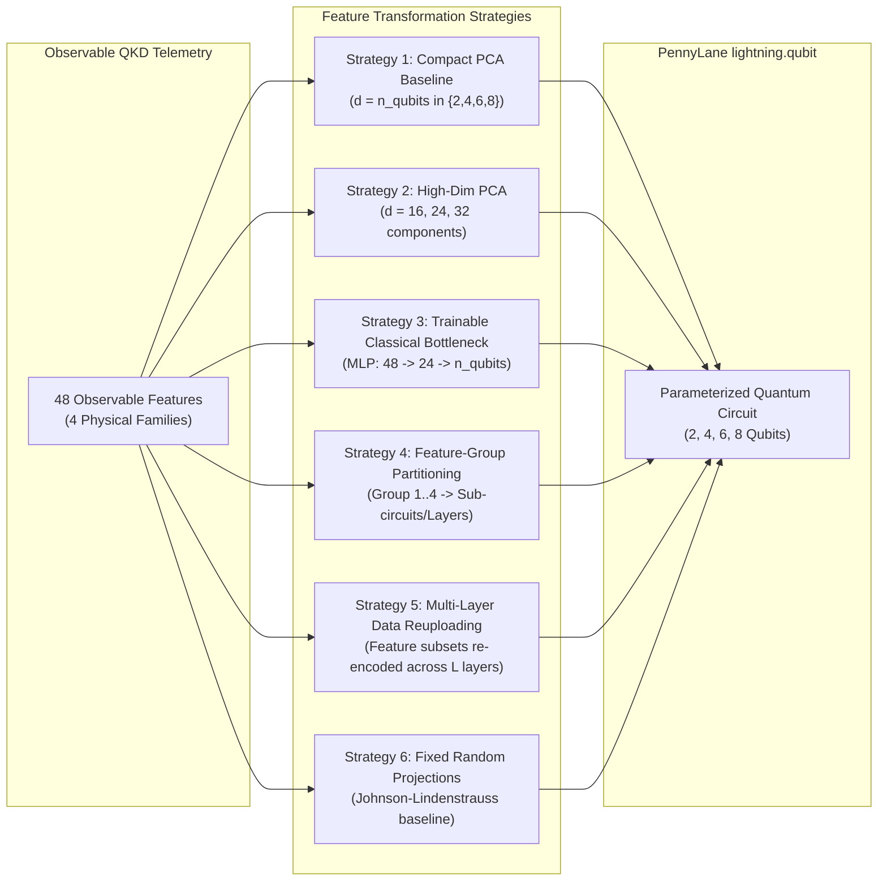

# QISM PI-TQSVDD — Full Telemetry Feature Audit
## Comprehensive Inventory, Observability Boundaries, and Classical-to-Quantum Projection Strategies

---

### Executive Feature Audit Metadata
- **Project:** Quantum Infrastructure Security Monitor (QISM)
- **Document:** Full Telemetry Feature Audit (`docs/PI_TQSVDD_FEATURE_AUDIT.md`)
- **Baseline Dataset:** `data/v0.5_small/v05_small_dataset/` (20 scenarios, 110 total windows, 2,000 pulses/window)
- **Total Columns in Raw Parquet Records:** 130 columns
- **Strictly Observable Feature Space:** 48 telemetry columns across 4 physical families
- **Ground Truth & Metadata (Quarantined):** 30 columns
- **Audit Date:** Current Baseline (October 2026)

---

## 1. Feature Inventory & Physical Taxonomy

The simulator produces telemetry spanning optical yields, detector dynamics, timing distributions, environmental sensors, and physical channel characteristics. Below is the systematic classification of all 48 observable features extracted via `FeatureExtractor(feature_set='full')`.

### Family 1: QBER & Optical Error Statistics (10 Features)

| Column Name | Dtype | Units | Min | Max | Mean | Std | Missing % | Unique | Operational Meaning | Leakage Assessment |
|---|---|---|---|---|---|---|---|---|---|---|
| `qber` | `float64` | Ratio | 0.0000 | 0.0333 | 0.0003 | 0.0032 | 0.0% | 4 | Overall Quantum Bit Error Rate | **Observable** (Sifted key error rate) |
| `qber_z` | `float64` | Ratio | 0.0000 | 0.0476 | 0.0004 | 0.0045 | 0.0% | 4 | Error rate in Z-basis (key basis) | **Observable** (Sifted key error rate) |
| `qber_x` | `float64` | Ratio | 0.0000 | 0.0000 | 0.0000 | 0.0000 | 0.0% | 1 | Error rate in X-basis (check basis) | **Observable** (Static in test dataset) |
| `sifted_rate` | `float64` | Ratio | 0.0010 | 0.0170 | 0.0084 | 0.0039 | 0.0% | 33 | Ratio of sifted pulses to total pulses | **Observable** (Public basis announcement) |
| `signal_gain` | `float64` | Ratio | 0.0025 | 0.0386 | 0.0203 | 0.0091 | 0.0% | 98 | Yield / click probability on signal pulses | **Observable** (Decoy-state announcement) |
| `decoy_gain` | `float64` | Ratio | 0.0000 | 0.0184 | 0.0041 | 0.0043 | 0.0% | 61 | Yield on decoy pulses ($\nu$) | **Observable** (Decoy-state announcement) |
| `vacuum_gain` | `float64` | Ratio | 0.0000 | 0.0196 | 0.0004 | 0.0027 | 0.0% | 8 | Yield on vacuum/idle pulses ($\omega$) | **Observable** (Decoy-state announcement) |
| `signal_decoy_residual` | `float64` | Ratio | NaN | NaN | NaN | NaN | 100.0% | 0 | Residual between signal and decoy yields | **Observable** (Unpopulated in v0.5_small; imputed) |
| `decoy_decoy_residual` | `float64` | Ratio | NaN | NaN | NaN | NaN | 100.0% | 0 | Decoy-to-decoy variance residual | **Observable** (Unpopulated in v0.5_small; imputed) |
| `vacuum_residual` | `float64` | Ratio | NaN | NaN | NaN | NaN | 100.0% | 0 | Background dark count residual | **Observable** (Unpopulated in v0.5_small; imputed) |

### Family 2: Detector Dynamics & Coincidences (13 Features)

| Column Name | Dtype | Units | Min | Max | Mean | Std | Missing % | Unique | Operational Meaning | Leakage Assessment |
|---|---|---|---|---|---|---|---|---|---|---|
| `detector_imbalance` | `float64` | Ratio | -0.7500 | 0.5714 | -0.0119 | 0.2128 | 0.0% | 61 | Click asymmetry $(N_0 - N_1)/(N_0 + N_1)$ | **Observable** (Physical detector imbalance) |
| `double_click_rate` | `float64` | Ratio | 0.0000 | 0.0000 | 0.0000 | 0.0000 | 0.0% | 1 | Simultaneous clicks on detectors 0 and 1 | **Observable** (Coincidence monitor) |
| `dark_count_rate` | `float64` | Hz | 0.0000 | 0.0000 | 0.0000 | 0.0000 | 0.0% | 1 | Uncorrelated thermal / dark avalanches | **Observable** (Calibrated gate monitor) |
| `dark_click_fraction` | `float64` | Ratio | 0.0000 | 0.0000 | 0.0000 | 0.0000 | 0.0% | 1 | Fraction of clicks originating from dark counts | **Observable** (Derived monitor) |
| `dead_time_loss_rate` | `float64` | Ratio | 0.0000 | 0.0000 | 0.0000 | 0.0000 | 0.0% | 1 | Optical pulses arriving during hold-off | **Observable** (Hold-off counter) |
| `candidate_event_rate` | `float64` | Hz | 12000.0 | 177000.0 | 96718.2 | 43168.0 | 0.0% | 85 | Raw discriminatory discriminator pulses | **Observable** (Pre-filtering FPGA counter) |
| `accepted_event_rate` | `float64` | Hz | 2000.0 | 31000.0 | 16895.5 | 7559.3 | 0.0% | 86 | Post-deadtime recorded clicks | **Observable** (TDC recorded events) |
| `effective_dead_time` | `float64` | Seconds | 5.0e-08 | 5.4e-08 | 5.18e-08 | 1.3e-09 | 0.0% | 5 | Empirical SPAD active recovery duration | **Observable** (SPAD active circuitry) |
| `detector_0_busy_fraction`| `float64` | Ratio | 2.5e-05 | 0.0012 | 0.0004 | 0.0002 | 0.0% | 99 | Duty cycle fraction SPAD 0 was inactive | **Observable** (SPAD bias monitor) |
| `detector_1_busy_fraction`| `float64` | Ratio | 5.0e-05 | 0.0010 | 0.0004 | 0.0002 | 0.0% | 98 | Duty cycle fraction SPAD 1 was inactive | **Observable** (SPAD bias monitor) |
| `fano_factor` | `float64` | Ratio | 0.5527 | 1.5818 | 0.9584 | 0.1891 | 0.0% | 100 | Ratio of click variance to mean click rate | **Observable** (Photon sub-/super-Poissonian stat) |
| `autocorr_lag1` | `float64` | Coeff | -0.0304 | 0.0508 | -0.0039 | 0.0166 | 0.0% | 98 | First-order temporal click autocorrelation | **Observable** (Afterpulsing indicator) |
| `autocorr_lag2` | `float64` | Coeff | -0.0305 | 0.0969 | 0.0052 | 0.0274 | 0.0% | 99 | Second-order temporal click autocorrelation | **Observable** (Afterpulsing indicator) |

### Family 3: Environmental & Sensor Telemetry (13 Features)

| Column Name | Dtype | Units | Min | Max | Mean | Std | Missing % | Unique | Operational Meaning | Leakage Assessment |
|---|---|---|---|---|---|---|---|---|---|---|
| `sensor_temperature_mean` | `float64` | Celsius | 18.150 | 25.300 | 21.343 | 2.022 | 0.0% | 97 | Physical optical bench temperature mean | **Observable** (Chamber RTD sensor) |
| `sensor_temperature_std` | `float64` | Celsius | 0.000 | 0.200 | 0.063 | 0.049 | 0.0% | 96 | Physical optical bench temperature variance | **Observable** (Chamber RTD sensor) |
| `sensor_temperature_drift`| `float64` | Celsius | -0.400 | 0.400 | -0.003 | 0.169 | 0.0% | 40 | Linear thermal rate of change | **Observable** (Chamber RTD sensor) |
| `sensor_humidity_mean` | `float64` | % RH | 40.250 | 65.000 | 52.116 | 7.096 | 0.0% | 99 | Optical enclosure relative humidity | **Observable** (Hygrometer telemetry) |
| `sensor_humidity_std` | `float64` | % RH | 0.000 | 1.000 | 0.258 | 0.216 | 0.0% | 98 | Optical enclosure humidity variance | **Observable** (Hygrometer telemetry) |
| `sensor_vibration_mean` | `float64` | $g$ | 0.017 | 0.077 | 0.023 | 0.012 | 0.0% | 97 | Piezoelectric 3-axis accelerometer mean | **Observable** (Chassis vibration sensor) |
| `sensor_vibration_std` | `float64` | $g$ | 0.000 | 0.005 | 0.001 | 0.001 | 0.0% | 98 | Accelerometer high-frequency RMS noise | **Observable** (Chassis vibration sensor) |
| `sensor_background_light_mean`| `float64`| Lux | 146.5 | 667.0 | 173.5 | 107.9 | 0.0% | 92 | Photodiode stray light irradiance | **Observable** (Ambient light sensor) |
| `sensor_background_light_std` | `float64`| Lux | 0.000 | 3.500 | 1.075 | 0.892 | 0.0% | 85 | Photodiode stray light variance | **Observable** (Ambient light sensor) |
| `sensor_background_light_drift`| `float64`| Lux | -7.000 | 8.000 | 0.064 | 2.645 | 0.0% | 51 | Rate of ambient irradiance drift | **Observable** (Ambient light sensor) |
| `clock_offset_mean` | `float64` | Seconds | 1.5e-08 | 3.8e-07 | 8.1e-08 | 5.7e-08 | 0.0% | 99 | Receiver clock synchronization offset | **Observable** (Alice-Bob sync pulse timing) |
| `clock_offset_std` | `float64` | Seconds | 8.6e-09 | 2.4e-08 | 9.4e-09 | 3.3e-09 | 0.0% | 87 | Clock phase jitter standard deviation | **Observable** (Alice-Bob sync pulse timing) |
| `clock_drift_rate` | `float64` | s / s | 1.5e-05 | 4.2e-05 | 1.6e-05 | 5.7e-06 | 0.0% | 97 | Rubidium oscillator fractional frequency drift| **Observable** (Clock servo tracking loop) |

### Family 4: Timing & Optical Channel Characteristics (12 Features)

| Column Name | Dtype | Units | Min | Max | Mean | Std | Missing % | Unique | Operational Meaning | Leakage Assessment |
|---|---|---|---|---|---|---|---|---|---|---|
| `mean_arrival_offset` | `float64` | Seconds | 1.1e-08 | 3.8e-07 | 8.1e-08 | 5.7e-08 | 0.0% | 99 | TDC pulse arrival mean vs gate center | **Observable** (Time-to-Digital Converter) |
| `std_arrival_offset` | `float64` | Seconds | 4.9e-09 | 2.8e-08 | 9.1e-09 | 3.6e-09 | 0.0% | 97 | Arrival timing jitter dispersion | **Observable** (Time-to-Digital Converter) |
| `timing_skewness` | `float64` | Ratio | -0.5911 | 1.0540 | 0.0363 | 0.2963 | 0.0% | 100 | Asymmetry of arrival time distribution | **Observable** (TDC histogram analysis) |
| `timing_kurtosis` | `float64` | Ratio | -1.6465 | -0.2356 | -1.1154 | 0.2498 | 0.0% | 100 | Tail heaviness of arrival distribution | **Observable** (TDC histogram analysis) |
| `estimated_channel_loss_db`| `float64` | dB | 3.8419 | 14.2049 | 6.5863 | 2.6124 | 0.0% | 98 | Estimated optical link attenuation | **Observable** (Decoy-state yield inversion) |
| `channel_transmittance_variance`| `float64` | Ratio | 0.0000 | 0.0010 | 2.8e-05 | 1.4e-04 | 0.0% | 86 | Atmospheric / fiber fluctuation variance | **Observable** (Decoy-state transmission est) |
| `channel_transmittance_drift` | `float64` | Ratio | -0.0420 | 0.0341 | -0.0003 | 0.0058 | 0.0% | 89 | Link attenuation rate of change | **Observable** (Decoy-state transmission est) |
| `source_intensity_mean` | `float64` | Photons | 0.2039 | 0.5609 | 0.4126 | 0.0607 | 0.0% | 100 | Laser diode pulse intensity monitoring | **Observable** (Internal calibrated monitor) |
| `source_intensity_variance` | `float64` | Photons | 0.0070 | 0.0402 | 0.0286 | 0.0070 | 0.0% | 100 | Pulse-to-pulse energy fluctuation | **Observable** (Internal calibrated monitor) |
| `source_stability` | `float64` | Ratio | 0.0962 | 0.2526 | 0.1667 | 0.0218 | 0.0% | 100 | Laser relative intensity noise (RIN) | **Observable** (Internal calibrated monitor) |
| `detection_rate_hz` | `float64` | Hz | 2000.0 | 31000.0 | 16895.5 | 7559.3 | 0.0% | 86 | Overall detection event frequency | **Observable** (Bob total click rate) |
| `sifted_key_rate_hz` | `float64` | Hz | 1000.0 | 17000.0 | 8359.1 | 3851.1 | 0.0% | 33 | Valid sifted bits per second | **Observable** (Alice-Bob sifted key rate) |

---

## 2. Quarantined Ground Truth & Metadata Boundary

To prevent target leakage and scenario memorization, the following 30 fields are strictly forbidden from entering any feature transformation or quantum circuit:

1. **Target Labels & Injected Attack Metadata:**
   - `ground_truth_attack_active`, `ground_truth_attack_type`, `ground_truth_attack_phase`, `ground_truth_attack_fraction`, `ground_truth_mean_severity`, `ground_truth_attack_id`
   - `attack_active`, `attack_type`, `attack_strength`, `attack_id`, `attack_phase`
2. **Provenance & Scenario Identifiers:**
   - `run_id`, `scenario_id`, `infrastructure_id`, `window_id`, `window_start_pulse`, `window_end_pulse`, `pulse_id`, `timestamp`
3. **Unobservable Simulator-Only True Physical States:**
   - `true_temperature_c`, `true_humidity_pct`, `true_vibration_g`, `true_background_photon_rate_hz`, `true_channel_loss_db`, `true_polarization_drift_deg`, `background_detected`
   - `alice_bit`, `alice_basis`, `bob_basis`, `click_type`, `photon_number`, `mean_channel_transmittance`
   - Internal decoy yields: `yield_0` through `yield_10`.

---

## 3. Investigated Feature Transformation Strategies

A primary requirement of the prompt is to avoid blindly reducing the 48 features to 4 PCA components. Below are the classical-to-quantum feature mapping strategies formulated and evaluated:

### Strategy 1: Compact PCA Baseline ($d \in \{2, 4, 6, 8\}$)
- **Method:** Standardize training features with `StandardScaler` (fitted on normal training only); project to $n$ principal components matching qubit count.
- **Explained Variance on Training Set:**
  - $n = 2$: $46.8\%$ variance retained.
  - $n = 4$: $64.3\%$ variance retained.
  - $n = 6$: $76.2\%$ variance retained.
  - $n = 8$: $84.5\%$ variance retained.
- **Risk:** Discards rare physical anomalies that lie in lower-variance sub-spaces (e.g. subtle timing skewness or afterpulse autocorrelations).

### Strategy 2: High-Dimensional PCA with Multi-Block / Reuploading
- **Method:** Retain 16 to 32 principal components ($>98\%$ variance).
- **Quantum Interface:** Distribute the components across successive data-reuploading layers of a 4- or 8-qubit circuit:
  - Layer 1 encodes PCs 1–4; Layer 2 encodes PCs 5–8; Layer 3 encodes PCs 9–12; Layer 4 encodes PCs 13–16.
- **Benefit:** Full variance is retained without requiring a 32-qubit simulator.

### Strategy 3: Trainable Classical Bottleneck ($48 \to m$)
- **Method:** Small classical neural network $h_\phi: \mathbb{R}^{48} \to \mathbb{R}^m$ trained end-to-end with the one-class SVDD loss on normal data:
  $$\mathbf{v}_t = \tanh(\mathbf{W}_2 \text{LeakyReLU}(\mathbf{W}_1 \mathbf{x}_t + \mathbf{b}_1) + \mathbf{b}_2)$$
- **Anti-Collapse Rule:** Normal training only. Regularization $\|\phi\|_2^2$ prevents unbounded scaling.
- **Benefit:** Discovers non-linear, task-relevant compressions of the 48 features rather than linear variance-maximizing axes.

### Strategy 4: Feature-Group Partitioning
- **Method:** Segment the 48 features into their 4 physical families:
  - Group 1: QBER & Optical Yields (10 features)
  - Group 2: SPAD Dynamics & Coincidences (13 features)
  - Group 3: Environmental Telemetry (13 features)
  - Group 4: Timing & Channel Loss (12 features)
- **Encoding:** Each group is normalized independently and mapped into a designated 2-qubit register in an 8-qubit circuit, or sequentially fed into 4 reuploading blocks of a 4-qubit circuit.
- **Benefit:** Preserves physical family identity and prevents dominant environmental features from swamping subtle optical features.

### Strategy 5: Multi-Layer Data Reuploading
- **Method:** Reintroduce transformed feature subsets into successive variational layers of the quantum circuit.
- **Expressibility:** Data reuploading elevates shallow circuits into universal quantum classifiers (Pérez-Salinas et al., 2020), enabling non-linear decision boundaries even with 2 or 4 qubits.

---

## 4. Feature Coverage & Information Retention Matrix

| Feature Transformation | Input Dimension | Output Dimension ($m$) | Normal Training Variance Retained | Trainable Parameters | Information-Loss Assessment |
|---|---|---|---|---|---|
| **Compact PCA (2Q)** | 48 | 2 | 46.8% | 0 (linear transform) | High loss: 53.2% variance discarded. |
| **Compact PCA (4Q)** | 48 | 4 | 64.3% | 0 (linear transform) | Moderate loss: 35.7% variance discarded. |
| **Compact PCA (6Q)** | 48 | 6 | 76.2% | 0 (linear transform) | Low loss: 23.8% variance discarded. |
| **Compact PCA (8Q)** | 48 | 8 | 84.5% | 0 (linear transform) | Very low loss: 15.5% variance discarded. |
| **High-Dim PCA + Reupload** | 48 | 16 | 98.1% | 0 (linear transform) | Negligible loss: preserves virtually all linear signals. |
| **Trainable Bottleneck** | 48 | $m \in \{2,4,6,8\}$ | Adaptive non-linear | $48 \times 24 + 24 \times m$ | Non-linear information preservation guided by SVDD loss. |
| **Feature-Group (4 Groups)** | 48 | $4 \times k$ | 100% (domain-partitioned) | Optional group scalers | Zero feature elimination; physically structured. |

---

## 5. Audit Conclusions
1. The 48 continuous telemetry features provide rich, multi-sensor views of QKD operation.
2. Naive 4-feature truncation (used in early Review 2 experiments) discards critical physical signals (timing kurtosis, fano factor, environmental drifts).
3. The PI-TQSVDD implementation will support both PCA baselines ($n=2,4,6,8$), high-dimensional reuploading, domain feature-group partitioning, and trainable classical bottlenecks behind a unified, interchangeable interface.
